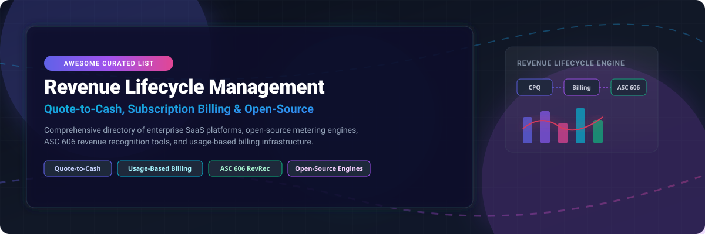

# 🚀 Awesome Revenue Lifecycle Management (RLM) &amp; Quote-to-Cash Ecosystem

> 💡 A curated directory of enterprise **Revenue Lifecycle Management (RLM)** platforms, **Quote-to-Cash (QTC)** solutions, **Subscription Billing Engines**, **Usage-Based Metering**, and **Open-Source Financial Ledger** projects.

---

## 📌 Executive Overview & Key Keywords

**Revenue Lifecycle Management (RLM)** orchestrates the end-to-end commercial operations of a business—unifying **Product Catalog Management**, **Configure, Price, Quote (CPQ)**, **Contract Lifecycle Management (CLM)**, **Subscription & Usage-Based Billing**, and **ASC 606 / IFRS 15 Revenue Recognition**.

### 🔍 Key Search Topics & Technical Domains
- 💵 **Quote-to-Cash (QTC) Automation**: End-to-end integration from initial sales quote to ledger posting and cash collection.
- ⚡ **Consumption & Usage-Based Metering**: Real-time event ingestion engines for cloud, API, and LLM token monetization.
- 📊 **Revenue Recognition (ASC 606 / IFRS 15)**: Automated performance obligation tracking, deferred revenue schedules, and financial auditability.
- 💳 **Payment Orchestration**: Smart routing, retries, and multi-processor card vault management.

---

## 📋 Table of Contents

- [🏢 SaaS & Hosted RLM Platforms](#-saas--hosted-rlm-platforms)
- [📊 Market Size & Structure Analysis](#-market-size--structure-analysis)
- [🔓 Open-Source Billing & Metering Infrastructure](#-open-source-billing--metering-infrastructure)
- [🛠️ Architectural Blueprint & Integration](#-architectural-blueprint--integration)
- [🤝 How to Contribute](#-how-to-contribute)
- [⚖️ Disclaimer & Regulatory Compliance](#-disclaimer--regulatory-compliance)
- [💖 Support & Community](#-support--community)
- [📈 Star History](#-star-history)

---

## 🏢 SaaS & Hosted RLM Platforms

### 📊 Market Size & Structure Analysis

> **Estimated Market Size & Industry Structure**: The global Revenue Lifecycle Management & Quote-to-Cash (QTC) software market is estimated at **$6.2 Billion in 2026** and is projected to reach **$12.8 Billion by 2030** (CAGR ~14.5%). The sector is **moderately to highly fragmented**—while market giants like Salesforce lead enterprise CRM integrations, specialized vendors (Zuora, Maxio, Icertis, Conga) and emerging open-source metering solutions (Lago, OpenMeter, Recurso) capture distinct market verticals, preventing a single winner-take-all outcome.

### 💰 Commercial SaaS Platforms (Sorted Descending by Company Valuation / Scale)

| SaaS Platform | Company Scale / Valuation | Starting Pricing | Free Tier / Trial Limit | Key Features & Best For |
| :--- | :--- | :--- | :--- | :--- |
| **[Salesforce RLM](https://www.salesforce.com/)** | **$280.0 Billion** (Market Cap) | **$150/user/mo** *(Growth)* / **$200/user/mo** *(Advanced)* | **30-day developer sandbox trial** *(Full RLM env)* | Native Salesforce product catalog, CPQ, contract lifecycle, billing, and automated revenue recognition. **Best for Salesforce enterprise ecosystems**. |
| **[Icertis](https://www.icertis.com/)** | **$5.0 Billion** (Valuation, $300M+ ARR) | **$2,000/mo** *(Base enterprise tier)* | **14-day guided test drive sandbox** *(Qualified access)* | AI-driven Contract Lifecycle Management (CLM), obligation tracking, and compliance intelligence. **Best for complex enterprise contract management**. |
| **[Zuora](https://www.zuora.com/)** | **$1.7 Billion** (Acquisition, $430M Revenue) | **$950/mo** *(Zuora Growth tier)* | **30-day test drive sandbox trial** *(Business email req.)* | The standard in subscription management, complex recurring billing, and automated revenue recognition. **Best for large recurring revenue enterprises**. |
| **[Conga RLM](https://conga.com/)** | **$1.5 Billion** (Valuation, $300M+ Revenue) | **$35/user/mo** *(Composer)* / **$150/user/mo** *(CPQ/RLM)* | **30-day free trial** *(via Salesforce AppExchange, 5 users)* | Quote-to-cash platform built on Salesforce offering CPQ, document generation, and contract billing. **Best for Salesforce-centric Revenue Operations**. |
| **[Model N](https://www.modeln.com/)** | **$1.25 Billion** (Acquired by WCAS, $250M Rev) | **$2,500/mo** *($30,000/yr starting tier)* | **14-day interactive demo sandbox** *(Upon request)* | Specialized revenue management, rebate execution, gross-to-net compliance, and channel pricing. **Best for Life Sciences & High-Tech manufacturing**. |
| **[BillingPlatform](https://billingplatform.com/)** | **$500 Million** (Valuation, $115M Raised) | **$1,500/mo** *($18,000/yr starting tier)* | **14-day interactive sandbox trial** *(Up to 10 test accounts)* | Enterprise monetization platform handling multi-attribute usage billing, complex rating engines, and ASC 606 schedules. **Best for complex enterprise billing**. |
| **[DealHub](https://dealhub.io/)** | **$400 Million** (Valuation, $90M Raised) | **$50/user/mo** *(Min. 10 seats / $500/mo)* | **14-day interactive sandbox trial** *(Up to 3 test users)* | Next-gen CPQ, digital deal rooms, subscription management, and quote-to-revenue workflows. **Best for B2B mid-market and enterprise sales teams**. |
| **[Maxio](https://www.maxio.com/)** | **$350 Million** (Valuation, $60M ARR) | **$599/mo** *(Essentials plan, up to $1M ARR)* | **14-day full feature free trial** *(No credit card required)* | Financial operations platform combining Chargify subscription billing with SaaSOptics SaaS metrics and revenue recognition. **Best for scaling B2B SaaS companies**. |
| **[Subskribe](https://www.subskribe.com/)** | **$100 Million** (Valuation, $20M Raised) | **$750/mo** *(Growth plan starting tier)* | **14-day interactive demo sandbox** *(Guided environment)* | Adaptive quote-to-cash platform unifying CPQ, multi-year subscription billing, and order management. **Best for modern SaaS subscription businesses**. |
| **[Monetize360](https://www.monetize360.com/)** | **$40 Million** (Valuation, $10M Raised) | **$499/mo** *(Starter tier starting price)* | **14-day free trial sandbox** *(Pre-populated test data)* | No-code pricing and billing engine designed to rapidly test hybrid, subscription, and consumption monetization models. **Best for agile pricing experimentation**. |

---

## 🔓 Open-Source Billing & Metering Infrastructure

### 🌟 Repositories (Sorted Descending by GitHub Star Count)

| Repository & Link | GitHub Stars | License | Core Capabilities & Best For |
| :--- | :--- | :--- | :--- |
| **[Hyperswitch](https://github.com/juspay/hyperswitch)** |  | Apache-2.0 | Open-source payment orchestration platform connecting 120+ payment processors via a single unified API with smart routing, card vault, and revenue recovery. **Best for high-volume payment routing**. |
| **[Lago](https://github.com/getlago/lago)** |  | AGPL-3.0 | High-performance metering and usage-based billing API built in Go. Designed for AI, API, and cloud infrastructure companies needing real-time event aggregation. **Best for usage-based billing at scale**. |
| **[Invoice Ninja](https://github.com/invoiceninja/invoiceninja)** |  | AGPL-3.0 | Mature open-source invoicing, recurring billing, expenses, and project tracking platform built with Laravel and Flutter. **Best for self-hosted invoicing & client management**. |
| **[Crater](https://github.com/crater-invoice/crater)** |  | AGPL-3.0 | Modern web and mobile open-source invoicing app designed for freelancers and small-to-medium businesses with automated payment reminders. **Best for sleek self-hosted invoicing**. |
| **[FlexPrice](https://github.com/flexprice/flexprice)** |  | Apache-2.0 | Flexible open-source pricing and billing infrastructure supporting flat-rate, tiered, usage-based, and prepaid credit models with a no-code admin panel. **Best for modular pricing infrastructure**. |
| **[Kill Bill](https://github.com/killbill/killbill)** |  | Apache-2.0 | Enterprise-grade subscription billing and payment platform with 15+ years of production history. Features versioned XML product catalogs, multi-phase subscription engine, Kaui admin UI, and custom plugin architecture. **Best for enterprise-grade self-hosted subscription billing**. |
| **[Autumn](https://github.com/useautumn/autumn)** |  | Apache-2.0 | Zero-webhook Stripe integration layer for AI applications. Implement usage metering, entitlement checks, and credit balances with minimal code. **Best for fast Stripe billing in AI startups**. |
| **[Laravel Cashier](https://github.com/laravel/cashier-stripe)** |  | MIT | Expressive, fluent interface to Stripe's subscription billing services for Laravel applications. Handles coupons, swap subscriptions, quantities, and payment cancellation grace periods. **Best for Laravel Stripe subscriptions**. |
| **[Paymenter](https://github.com/paymenter/paymenter)** |  | MIT | Open-source client management and billing portal tailored for hosting, cloud, and server providers with automated provisioner integrations. **Best for web hosting & infrastructure billing**. |
| **[OpenMeter](https://github.com/openmeterio/openmeter)** |  | Apache-2.0 | Real-time usage metering engine built on Kafka and ClickHouse. Features first-class LLM token cost tracking, prepaid credit balances, and graduated pricing models. **Best for AI agent & API token monetization**. |
| **[Lotus](https://github.com/uselotus/lotus)** |  | MIT | Open-source pricing experimentation platform built with Python. Test and deploy complex billing models, usage metering, and real-time revenue analytics. **Best for pricing experimentation**. |
| **[Meteroid](https://github.com/meteroid-oss/meteroid)** |  | AGPL-3.0 | High-performance Rust-native open-source billing platform designed for product-led growth (PLG) SaaS products. **Best for Rust microservice billing stacks**. |
| **[SolidInvoice](https://github.com/solidinvoice/solidinvoice)** |  | MIT | Simple open-source billing and invoicing application built with Symfony for freelancers and small businesses. **Best for lightweight self-hosted invoicing**. |
| **[Tier](https://github.com/tierrun/tier)** |  | Apache-2.0 | SDK and CLI to define and enforce SaaS pricing models in code, backed by Stripe Billing. **Best for developer-centric pricing enforcement**. |
| **[UniBee](https://github.com/UniBee-Billing/unibee)** |  | AGPL-3.0 | Universal open-source billing software for SaaS businesses featuring product tier management, webhooks, transaction tracking, and Docker Compose deployment. **Best for self-hosted universal billing**. |
| **[Recurso](https://github.com/recurso-dev/recurso)** |  | MIT | Open-source Go billing engine featuring a built-in double-entry financial ledger, ASC 606 revenue recognition, bandit-retry dunning, and India GST compliance. **Best for double-entry ledger & ASC 606 compliance**. |

---

## 🛠️ Architectural Blueprint & Integration

When constructing an enterprise-grade or modern PLG Revenue Lifecycle Management system:

1. 🔄 **Subscription Engine**: Deploy **[Kill Bill](https://github.com/killbill/killbill)** or **[UniBee](https://github.com/UniBee-Billing/unibee)** for standard catalog management, subscription state transitions, and proration.
2. ⚡ **Real-time Metering**: Integrate **[Lago](https://github.com/getlago/lago)** or **[OpenMeter](https://github.com/openmeterio/openmeter)** for high-throughput event processing and LLM token usage calculation.
3. 📖 **Financial Ledger & ASC 606**: Utilize **[Recurso](https://github.com/recurso-dev/recurso)** for immutable double-entry ledger tracking, GAAP compliance, and deferred revenue schedules.
4. 💳 **Payment Gateway Routing**: Integrate **[Hyperswitch](https://github.com/juspay/hyperswitch)** to achieve multi-processor redundancy, reduce gateway processing fees, and automate card retries.

---

## 🤝 How to Contribute

1. 🍴 Fork this repository.
2. 🌿 Create a feature branch (`git checkout -b add-new-rlm-platform`).
3. 📝 Add your entry following the tabular format above with verified pricing, free trial specs, and official links.
4. 🚀 Submit a Pull Request with context on the platform/repo.

---

## ⚖️ Disclaimer & Regulatory Compliance

- ℹ️ This repository is a **community-curated index** for informational and educational purposes.
- 🔒 **Financial Compliance**: RLM tools process critical revenue data subject to regulatory standards including **ASC 606**, **IFRS 15**, **PCI-DSS Level 1**, and tax laws (**US Sales Tax**, **EU VAT**, **India GST**).
- 🛡️ **Security & Hosting**: Self-hosting open-source billing components requires appropriate database encryption, audit logs, and access control policies.

---

## 💖 Support & Community

Thank you for visiting and supporting this ecosystem directory! If you find this resource helpful for evaluating Revenue Lifecycle Management, Quote-to-Cash, or Subscription Billing software:

- ⭐ **Star** this repository to help spread the word!
- 🍴 **Fork** it to keep a personal copy or submit improvements.
- 📢 **Share** it with your engineering, RevOps, and product teams.
- ☕ **Sponsor / Buy Me a Coffee**: If you'd like to support ongoing updates and open-source maintenance, please consider sponsoring via [GitHub Sponsors](https://github.com/sponsors/ishandutta2007)!

---

## 📈 Star History

